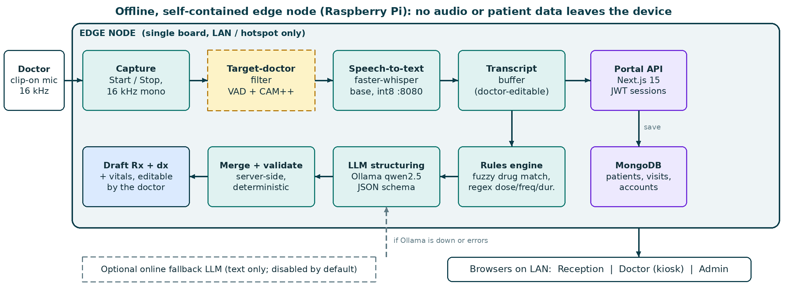
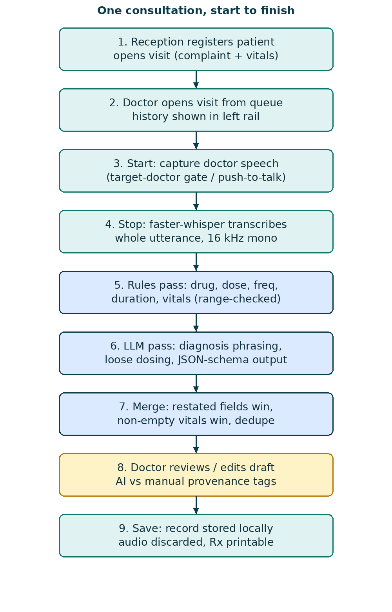
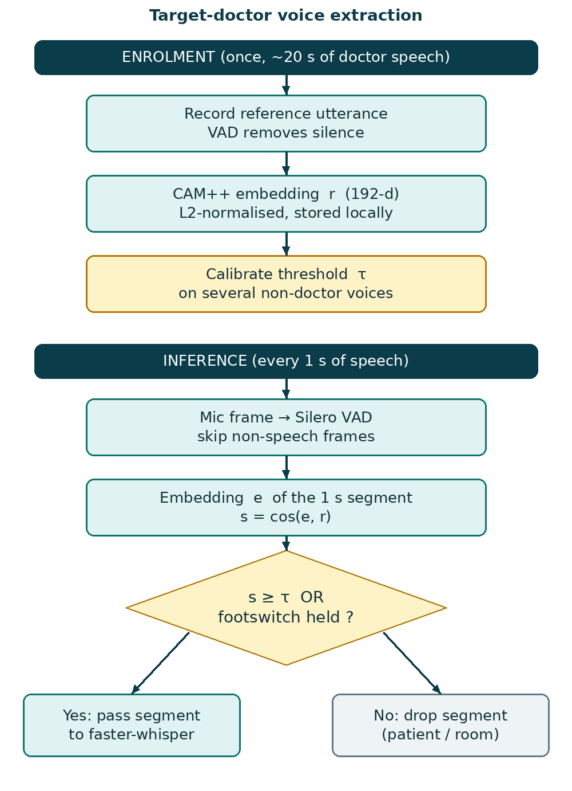
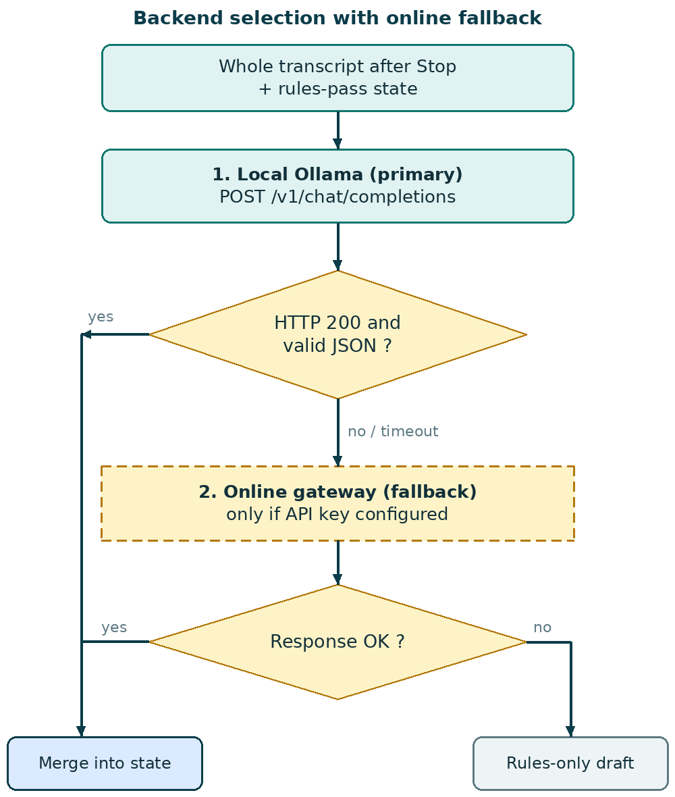
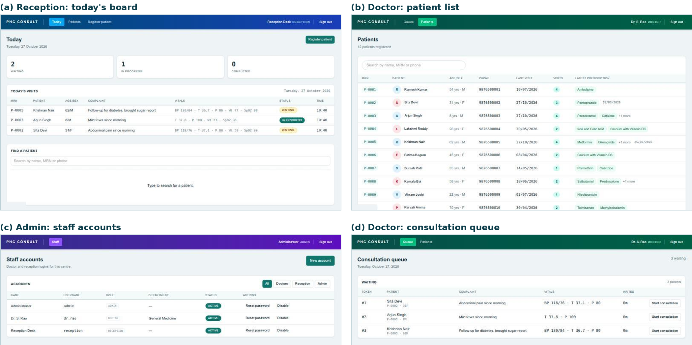
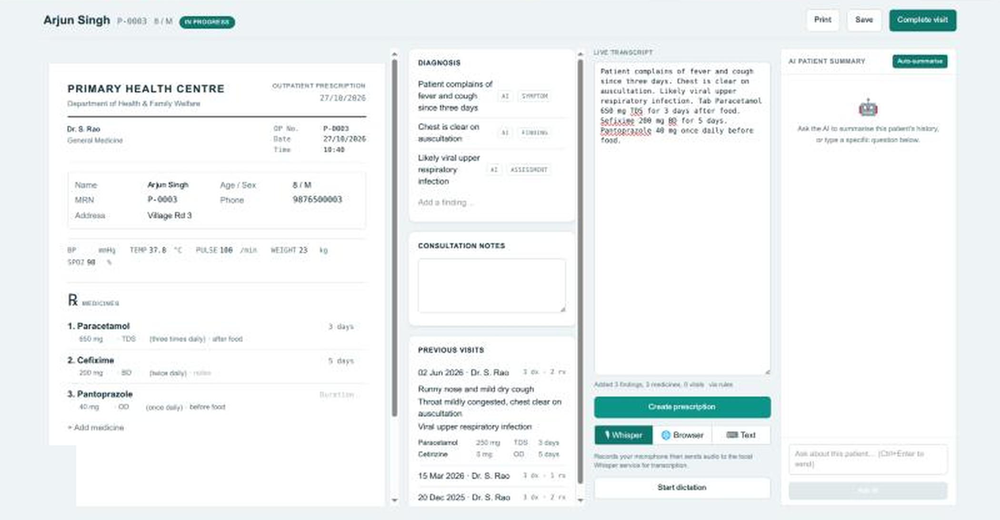
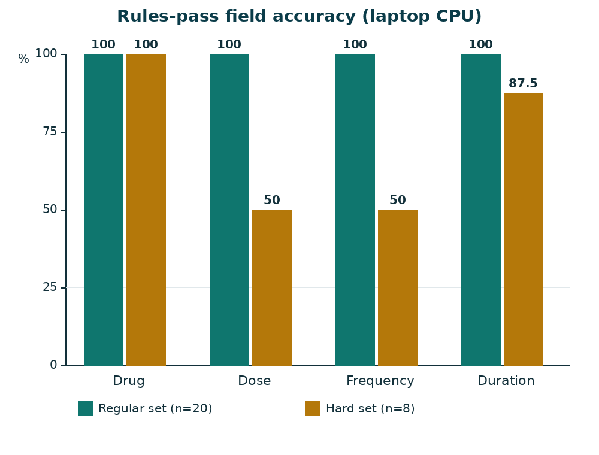

# PHC Voice Prescription

**Edge-deployed target-doctor voice extraction and NLP-based prescription drafting for Primary Health Centres.**


A doctor dictates a consultation, and the system turns the speech into an **editable draft prescription**
(vitals, diagnosis findings, medicines with dose, frequency and duration). Everything runs on a single
low-power board on the doctor's desk, so patient audio never leaves the room and the system keeps working
when the network does not.

> The device suggests text; it never prescribes. The doctor reviews and edits every line, and nothing is
> stored until the doctor presses **Save**.

**Contents**
[Why](#why-this-project) ·
[Features](#features) ·
[How it works](#how-it-works) ·
[The portal](#the-portal) ·
[Results](#results) ·
[Status](#status-and-limitations) ·
[Tech stack](#tech-stack) ·
[Project structure](#project-structure) ·
[Documentation](#documentation) ·
[License](#license) ·
[Contributors](#contributors)

---

## Why this project

A Primary Health Centre (PHC) doctor often sees 60–120 patients a day, which leaves about two minutes for each one.
In that time the prescription is written by hand in a hurry:

- **Legibility.** Handwritten prescriptions are misread at the pharmacy counter.
- **No record.** Nothing is stored digitally, so the next visit starts from zero.
- **Typing does not help.** An on-screen form takes as long as writing and breaks eye contact with the patient.
- **Cloud speech is a poor fit.** PHC internet access is unreliable, and consultation audio is sensitive personal data.

Speech is the natural input, because the doctor already says the findings and the medicines aloud. This project
makes that practical on an offline edge device.

## Features

- **Fully offline pipeline.** On-device speech-to-text ([faster-whisper](https://github.com/SYSTRAN/faster-whisper), int8) and a small local LLM served by [Ollama](https://ollama.com).
- **Single-pass structuring.** The doctor presses Start, talks freely in any order, presses Stop, and the whole transcript becomes vitals, diagnosis and prescription together.
- **Robust to speech errors.** Mis-heard drug names are corrected by fuzzy matching against a 195-generic essential-medicines list ("Sefixime" becomes **Cefixime**).
- **Spoken self-corrections.** "Actually make that 400 mg" updates the existing line instead of adding a new one.
- **Hybrid, auditable extraction.** Closed-grammar fields (drug, dose, frequency, duration, vitals) are deterministic; the LLM handles free-text diagnosis and loosely worded dosing.
- **Never blocks the consultation.** If the local LLM fails, an optional online fallback is tried, and if that fails too, the rules-only draft is kept.
- **Doctor in the loop.** Every line is editable and tagged AI or manual; the prescription prints from the same screen.
- **Role-based web portal.** Reception, doctor and admin each get their own screens, with local MongoDB storage.
- **Patient history on screen.** Earlier visits sit beside the draft, and an optional AI chat answers questions about a patient's history.
- **Queue status page.** Patients can look up their place in today's queue by MRN.

## How it works

### Architecture



*Offline, self-contained architecture. The dashed amber block (target-doctor filter) is specified below and is the next
module to integrate; the dashed grey block is the optional online fallback.*

A clip-on microphone worn by the doctor feeds a capture stage. Speech is transcribed by a local faster-whisper service
into an editable transcript. When the doctor presses Stop, the transcript is sent once to the portal API, where a rules
engine and a local LLM structure it. A deterministic merge step combines the result with what reception already entered,
and the draft appears on screen. Model weights, the drug list and the database are all local; the only optional outbound
path is the online fallback LLM, which is off by default and carries transcript text only, never audio.

### One consultation, start to finish

<p align="center"></p>

1. **Reception** registers the patient (an MRN such as `P-0001` is generated) and opens a visit with the complaint and vitals. One open visit per patient per day.
2. **Doctor** opens the visit from the queue and sees the patient's earlier visits.
3. **Start / Stop** brackets the dictation.
4. **faster-whisper** transcribes the speech on the device.
5. **Rules pass** finds drugs, dose, frequency, duration and vitals.
6. **LLM pass** (optional) phrases diagnosis findings and resolves loose dosing.
7. **Merge** combines everything with the existing visit state.
8. **Doctor reviews and edits** the draft.
9. **Save** stores the record locally.

### Target-doctor voice extraction

<p align="center"></p>

Only the doctor's voice should reach the recogniser. The design enrols the doctor once with about 20 s of speech,
stores a 192-dimensional CAM++ speaker embedding **r**, and then compares every second of detected speech with it:

$$s = \frac{e \cdot r}{\lVert e \rVert \, \lVert r \rVert}, \qquad \text{pass the segment if } s \ge \tau \ \text{ or the footswitch is held}$$

The threshold τ is calibrated on several non-doctor voices, and a physical footswitch makes the gate deterministic for
the drug-name utterance, which is the most safety-critical part of the dictation. Voice activity detection (Silero) drops
non-speech frames first.

> **Implementation status:** this filter is **specified but not yet integrated** into the portal. Today the system relies
> on a doctor-worn close-talk microphone and explicit Start/Stop, which acts as a push-to-talk gate.

### Speech-to-text

faster-whisper runs as a small local HTTP service ([`scripts/whisper_server.py`](scripts/whisper_server.py)) that exposes
`/inference` (whisper.cpp style) and `/v1/audio/transcriptions` (OpenAI style). Audio is converted to 16 kHz mono with
ffmpeg and transcribed in int8 on the CPU. Because the whole transcript is processed after Stop, no streaming decoder
is needed. faster-whisper also supports a hotwords option for biasing decoding towards the drug list. The doctor can also
choose browser speech recognition or typed text as the transcript source; all three fill the same buffer.

### Extraction engine

The transcript is split into sentences, and each sentence goes through the rules engine
([`lib/extract.ts`](lib/extract.ts), [`lib/drugs.ts`](lib/drugs.ts), [`lib/vitals.ts`](lib/vitals.ts)).

**Drug names** are recovered by fuzzy matching every word and word pair against the drug list, using a normalised
Levenshtein similarity:

$$\mathrm{sim}(a,b) = 1 - \frac{\mathrm{lev}(a,b)}{\max(|a|,|b|)}$$

with a small bonus for prefixes, an acceptance threshold of 0.72, an exact-match-only rule below four characters, and a
stopword list so that words like "and" cannot match inside multi-word entries such as "Iron and Folic Acid".

**Dose, frequency, duration and notes** come from regular expressions covering `500 mg`, `OD/BD/TDS/QID/HS/SOS/STAT`,
`1-0-1`, "twice a day", "for 5 days", "x 5 days", "after food" and similar forms.

**Vitals** (BP, temperature, pulse, SpO₂, weight) are matched by regular expressions and kept only if physiologically
plausible, so a pulse of 900 is rejected. Vitals-only sentences update the vitals and never become diagnosis lines.

**Merge rules** are applied server-side and deterministically, never by the LLM:

| Target | Merge key | Rule |
|---|---|---|
| Prescription | Drug (fuzzy) | One line per drug; a restated field overwrites the earlier value, unrestated fields are kept |
| Diagnosis | Normalised text | Deduplicated on lower-cased, whitespace-collapsed text |
| Vitals | Field name | Non-empty wins: a dictated value overwrites reception's entry, an unmentioned field keeps it |

### LLM structuring with an online fallback

<p align="center"></p>

When enabled, a second pass sends the whole transcript and the rules output to a local instruction-tuned model
(Qwen2.5 through Ollama's OpenAI-compatible endpoint) with temperature 0 and a JSON schema for the response. The prompt
forbids inventing doses, keeps only the final corrected value of a restated item, and fills a vital only if a number was
stated. Any drug name in the output is passed through the same fuzzy matcher before merging.

Backend selection ([`lib/llm.ts`](lib/llm.ts)) tries the local Ollama server first. If it times out or errors, and only
if a fallback key is configured, the same request goes to an online OpenAI-compatible gateway. If that also fails, the
rules-only draft is kept. The online path is **off by default** because it sends transcript text off the device and
needs the patient's consent. See [`docs/DEPLOYMENT.md`](docs/DEPLOYMENT.md#llm-backends-and-the-online-fallback).

## The portal

Three roles, each with its own navigation-bar colour:

| Role | What they do |
|---|---|
| **Admin** | Creates and disables doctor and reception accounts. Cannot disable the last active admin or itself. |
| **Reception** | Registers patients, searches records, and opens a visit with complaint and vitals. |
| **Doctor** | Works the day's queue, dictates, edits the draft, prints the prescription, saves and completes the visit. |



*(a) reception board, (b) doctor patient list, (c) admin staff accounts, (d) doctor consultation queue.*

The consultation screen has the patient and previous visits on the left, the editable draft prescription in the centre,
and the transcript with its Whisper, Browser and Text sources on the right:



*The sample dictation "...Tab Paracetamol 650 mg TDS for 3 days after food. Sefixime 200 mg BD for 5 days. Pantoprazole
40 mg once daily before food." produced three findings and three medicines; the mis-heard "Sefixime" became Cefixime,
and Pantoprazole's duration was left blank because the doctor did not state one. The system never invents a value.*

## Results

Measured on a laptop (Intel Core Ultra 5 225H, 14 cores, 16 GB RAM, no discrete GPU) with the LLM turned off, using
dictated lines written by the authors (not recorded speech).



| Metric | Regular set (n=20) | Hard set (n=8) |
|---|---|---|
| Drug name | 20/20 (100%) | 8/8 (100%) |
| Dose | 20/20 (100%) | 4/8 (50%) |
| Frequency | 20/20 (100%) | 4/8 (50%) |
| Duration | 20/20 (100%) | 7/8 (87.5%) |
| All four fields | 20/20 (100%) | 1/8 (12.5%) |
| Mis-heard drug names recovered | 15/15 | |
| False prescription lines on 10 non-drug sentences | 0/10 | |
| Vitals fields | 10/10 | |
| Unit-test assertions | 23/23 pass | |

The rules pass takes **74 ms** for a 56-word consultation on the laptop. On the hard set, every failure was an
*omission* (an empty or partial field), never a wrong value, so the doctor sees a visible gap rather than a plausible
but incorrect entry. The failures come from spelled-out numbers ("five hundred milligrams"), long unit names, unlisted
frequency phrases ("every six hours", "morning and night") and vague durations ("about a week"), which is where the
LLM leg and the doctor's review matter.

Reproduce the numbers:

```bash
pnpm test:extract      # 23 assertions over the extraction rules
pnpm eval:extract      # labelled field-accuracy and latency script
```

On-device (Raspberry Pi) timings are **not yet measured** in this repository; use
[`scripts/bench_pi.py`](scripts/bench_pi.py) (see [`docs/DEPLOYMENT.md`](docs/DEPLOYMENT.md#benchmarking)).

## Status and limitations

| Area | Status |
|---|---|
| Role-based portal, queue, history, printable prescription | Implemented |
| faster-whisper service and three transcript sources | Implemented |
| Rules engine, merge rules, vitals range checks | Implemented, tested |
| Local LLM structuring and online fallback | Implemented, not benchmarked |
| Target-doctor filter (CAM++ + VAD + footswitch) | Specified, **not yet integrated** |
| Word error rate on recorded doctor speech | Not measured |
| Raspberry Pi latency, memory and temperature | Not measured |
| Clinician usability study | Not done |

Test inputs are author-written text, so speech-recognition errors are only simulated. Using the online fallback sends
transcript text off the device and needs explicit patient consent. This is a research prototype and is **not a medical
device**: it must not be used for real patient care without clinical validation.

## Tech stack

| Layer | Choice |
|---|---|
| Web app | Next.js 15 (App Router), React 19, TypeScript, Tailwind CSS 4 |
| Data and auth | MongoDB (official driver), `jose` JWT sessions, `bcryptjs` password hashes |
| Speech-to-text | faster-whisper (CTranslate2), int8, CPU; ffmpeg for audio conversion |
| Local LLM | Ollama with Qwen2.5 (1.5B or 3B, Q4), OpenAI-compatible API, JSON-schema output |
| Matching | 195-generic essential-medicines list, Levenshtein similarity |
| Planned | sherpa-onnx with Silero VAD and CAM++ speaker embeddings |

## Project structure

```
app/                  Next.js routes: admin, reception, doctor, login, token (queue status), API handlers
  api/visits/[id]/structure/   single-pass transcript structuring
  api/transcribe/              forwards audio to the Whisper service
  api/patients/[id]/summarise/ patient-history assistant
components/           Shell (role navigation bar) and shared UI
lib/                  extract.ts, drugs.ts, vitals.ts, llm.ts, auth.ts, db.ts, types.ts
data/drugs.txt        195-generic essential-medicines list
scripts/              seed, whisper_server.py, setup/install/run scripts, test-extract.ts, eval-extract.ts, bench_pi.py
docs/                 DEPLOYMENT.md and the figures used in this README
```

## Documentation

- **[Deployment and setup guide](docs/DEPLOYMENT.md):** local development, Raspberry Pi deployment, configuration, the online fallback, benchmarking and troubleshooting.

## License

Copyright (c) 2026 the contributors listed below.

Released under the **[PolyForm Noncommercial License 1.0.0](LICENSE)**.

- You **may** use, copy, modify and share this software for **noncommercial purposes** (personal use, research,
  study, education, and use by charitable, educational and public-interest organisations, as defined in the license).
- You **must** keep the `Required Notice:` line and a copy of the license (or its URL) with every copy you pass on.
  Please also credit the project and its contributors in any work that builds on it.
- You **may not** use it for **commercial purposes**. For a commercial licence, contact the contributors.

The [LICENSE](LICENSE) file is the legally binding text; the summary above is not a substitute for it.

## Contributors

Course project for **Embedded Systems (BCSE305L)** at Vellore Institute of Technology.

| Name | Register No. | GitHub |
|---|---|---|
| Adithyan P | 24BCE1168 | [@legitcoconut](https://github.com/legitcoconut) |
| Rohit Anil Kumar | 24BCE5211 | [@RohitAnilKumar](https://github.com/RohitAnilKumar) |
| Nevin S | 24BCE1358 | |
| Bhadra Nair U B | 24BCE5235 | |
| Ayana Biju | 24BCE1819 | |

## Citation

If you build on this work, please cite it as:

> A. P, R. A. Kumar, N. S, B. Nair U B and A. Biju, "Edge-Deployed Target-Doctor Voice Extraction and NLP-Based
> Prescription Drafting for Primary Health Centres," course project, Vellore Institute of Technology, 2026.
